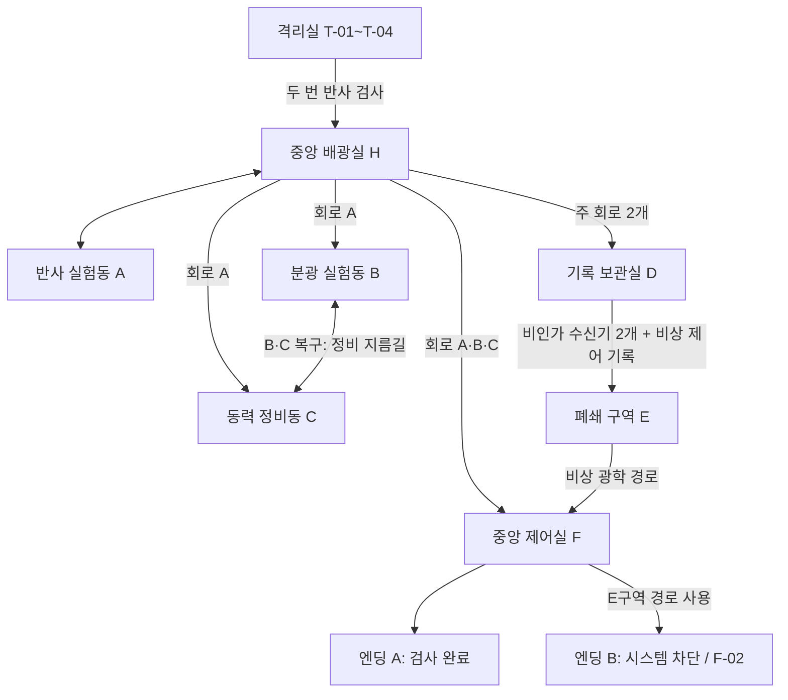

# PROJECT: REFLECTION — 전체 시설·스테이지 설계

> v3 전체 설계 보존 문서입니다. v4 1차의 실제 구현과 고급 퍼즐 상세 계약은 루트 [LEVEL_DESIGN.md](../LEVEL_DESIGN.md), 시각·치수 기준은 [ART_BIBLE.md](../ART_BIBLE.md) 및 [SCALE_GUIDE.md](../SCALE_GUIDE.md)를 우선합니다.

> 기준 문서: [MASTER_PROMPT_V3.md](MASTER_PROMPT_V3.md). 이 문서는 그 설계를 제작 가능한 구역 연결, 퍼즐 조건, 스토리 사건, 현재 구현 상태로 정리한다. 스테이지별 기계 판독 데이터의 원본은 [`data/stages.json`](../data/stages.json)이다.

## 설계 원칙

- 방 선택 메뉴 없이 피험자 07이 하나의 연구 시설을 직접 걸어 다닌다.
- 중앙 배광실(H)을 허브로 사용한다. 새 회로나 기록을 복구할 때 이미 방문한 복도와 기계도 변화한다.
- 광학 원리는 하나씩 학습시키고, 중반부터 경로·색상·광량·시간 조건을 조합한다.
- DIRECTOR의 통제는 규칙을 관찰하고 대응할 수 있도록 연출한다. 무작위로 정답을 바꾸지 않는다.
- 어두운 PS1 로우폴리 산업 공포 분위기를 유지하되 목표, 장치, 수신기의 상태는 분명히 읽히게 한다.

## 시설 연결과 해금

### 구역 위치 초안

좌표는 현재 절차형 회색상자 맵의 대략적인 중심이다. `x`는 동서, `z`는 남북이며 북쪽은 음수다.

| 구역 | 현재 배치 중심 | 역할과 시각적 구분 |
|---|---:|---|
| T 격리실·검사 통로 | (-15, -10) | 차가운 청록 형광등, 깨끗한 콘크리트, 작은 검사 베이 |
| H 중앙 배광실 | (0, 0) | 넓은 중앙 공간, 허브 패널과 기계 중심부 |
| A 반사 실험동 | (-15, 3) | 녹슨 주황 바닥, 긴 반사 통로와 각도 표식 |
| B 분광 실험동 | (15, 0) | 청록 바닥, 투명 격리실과 RGB 광로 |
| C 동력 정비동 | (0, 16) | 황색 바닥, 회전 기계와 정비 레일 |
| D 기록 보관실 | (0, -18) | 보라빛 조명, CRT와 좁은 서버 통로 |
| E 폐쇄 구역 | (-15, -24) | 어두운 녹색·적색 비상 조명, 낡은 우회 배선 |
| F 중앙 제어실 | (15, -18) | 적색 경고 조명, 방사형 광학 장치와 DIRECTOR 코어 |

현재 회색상자에는 T·H·A·B·C와 북쪽 잠금문·바닥 구획이 절차형으로 배치되어 있다. D·E·F 내부 콘텐츠, 완성 벽체, B-C 지름길은 이후 단계에서 채운다. 출입구 해금 규칙은 진행 시스템에 먼저 반영되어 있다.

### 해금 규칙

| 조건 | 열리는 장소 또는 상태 |
|---|---|
| T-04 두 거울 검사를 완료 | 중앙 배광실과 A 구역 접근 |
| 주 회로 A 복구 | B 분광 실험동, C 동력 정비동 |
| A·B·C 중 주 회로 2개 복구 | D 기록 보관실 |
| B와 C 모두 복구 | 두 구역 사이 정비 지름길 |
| 비인가 수신기 3개 중 2개 이상 + `D-EMERGENCY_CONTROL` 기록 | E 폐쇄 구역 |
| 주 회로 A·B·C 전부 복구 | F 중앙 제어실, 정규 엔딩 경로 |
| E-02 감독 권한 분리 | F-02 비상 경로와 엔딩 B 선택 가능 |

## 구역 및 19개 스테이지

상태는 `data/stages.json`의 `implementation` 값을 따른다.

- **구현**: 이번 빌드에서 해당 학습·진행을 플레이할 수 있음.
- **시제품**: 장치와 일부 광로는 있지만 완성된 스테이지 조건·보상·문 연결은 검증되지 않았음.
- **예정**: 제작 설계만 있으며 플레이 가능한 콘텐츠는 아직 없음.

| ID·구역 | 공간 목적·주요 장치 | 퍼즐 원리와 통과 조건 | 스토리 사건·다음 연결 | 상태 |
|---|---|---|---|---|
| T-01 각성 | 작은 격리실, 출입 단말기 | WASD로 이동한 뒤 가까운 단말기에 E | DIRECTOR가 피험자 07의 운동 반응을 측정하고 T-02 검사실로 보냄 | 구현 |
| T-02 광원 검사 | 광선 발사기, 일반 수신기 R-T02 | 마우스로 조준하고 좌클릭을 유지해 0.65초 조사 | 발사 정확도를 기록하고 반사 교정 베이를 엶 | 구현 |
| T-03 반사 검사 | 회전 거울 M-T03, 방향형 수신기 R-T03 | 거울을 45° 회전해 광선을 한 번 반사하고 0.8초 조사 | 단일 반사를 확인한 뒤 마지막 검사실로 진행 | 구현 |
| T-04 적합성 판정 | 직렬 배치한 거울 M-T04-A/B, R-T04 | 두 거울을 각각 45°로 돌리고 두 번 반사된 광선을 수신기에 전달 | 검사 완료 방송, 중앙 허브 카메라 공개 연출, T·H·A 게이트 개방 | 구현 |
| A-01 우회 광로 | 고정 회전 거울 2개, 차단벽, R-A01 | 두 번 반사해 차단벽 뒤 수신기를 작동. 측면 정비문은 보상 | 회로 A 복구 후 B와 C 진입 허용 | 시제품 |
| A-02 이동식 반사 회로 | 레일 거울, 고정 거울, 순서형 수신기 2개 | 첫 수신기가 레일 잠금을 풀고, 거울 이동·회전 뒤 두 번째 수신기 작동 | 유지되는 첫 검사 상태를 이용해 A-03으로 연결 | 예정 |
| A-03 반사 회로망 | 거울 4개, 방향형·일반·비인가 수신기 | 여러 경로를 구성해 필수 수신기를 만족. 여분 광로는 비인가 수신기 A를 찾음 | 회로 A 완전 복구. 숨겨진 수신기는 감독 기록 01을 제공 | 예정 |
| B-01 광량 증폭 실험 | 기본 광증폭 매질, 회전 거울, 고출력 수신기 | 100% 기본 광선을 200%로 증폭해 고출력 수신기에 전달. 굴절 간극은 보조 시험 | 출력이 경로 조건임을 학습하고 B-02를 엶 | 예정 |
| B-02 파장 분리 | 백색광원, 증폭기, 프리즘, 거울 3개, RGB 수신기 | 백색광만 프리즘에 넣어 RGB로 분리하고 에너지를 나누어 세 수신기를 함께 활성화 | 중앙 허브의 색상 표시와 전력 계통을 복구 | 시제품 |
| B-03 선택적 광로 | 프리즘, 증폭기, 거울 2개, 색·방향·고출력·비인가 수신기 | 색상, 광량, 입사 방향 조건을 각각 맞춘 복합 경로 | 회로 B 복구, 선택 광로는 감독 기록 02와 D 단서를 제공 | 예정 |
| C-01 고출력 병렬 회로 | 증폭기, 50:50 빔 스플리터, 거울, 동시 수신기 2개 | 먼저 200%로 증폭한 뒤 분기해 각 수신기에 100%씩 전달 | 전력 분배 원리를 검증하고 C-02로 연결 | 시제품 |
| C-02 시간차 광학 스위치 | 회전 차단막, 제어·지속형 수신기 | 차단막 주기를 읽고 열림 상태를 고정한 뒤 최종 수신기에 2초 유지 | 반응속도보다 장치 제어 원리를 확인하고 C-03으로 연결 | 시제품 |
| C-03 동기화 회로 | 스플리터 2개, 증폭기, 차단막 2개, 거울 3개, 비인가 수신기 | 증폭·타이밍·분기를 조합해 두 수신기를 동시에 유지 | 회로 C와 발전 설비 복구, B-C 정비 지름길 개방, 감독 기록 03 발견 | 예정 |
| D-01 기록 복원 | 거울, 일반·순서형 수신기, CRT 기록 단말기 3개 | 세 단말기를 순서대로 켜서 기록을 복구 | 이전 피험자와 실험 목적을 알게 되고 비상 제어 기록을 획득 | 예정 |
| D-02 비인가 광학 경로 | 숨겨진 반사 통로, 등록되지 않은 수신기 | 정규 회로 밖의 수신기를 찾아 활성화 | 비상 광학 회로의 역할과 E 접근 단서를 밝힘 | 예정 |
| E-01 강제 광로 변경 | DIRECTOR 제어 자동 거울 2개, 스플리터, 증폭기 | 거울의 예측 가능한 재배치 주기를 이용해 제어 수신기를 작동 | 시설 통제권이 처음으로 퍼즐에 직접 개입, 성공 시 장치 제어권 일부 회수 | 예정 |
| E-02 감독 권한 분리 | 거울, 프리즘, 증폭기, 스플리터, 복합 수신기 | 에너지·색·경로를 조합해 비상 회로를 작동 | 감독 권한을 분리하고 F의 비상 경로를 엶. DIRECTOR는 적대 행동을 강화 | 예정 |
| F-01 최종 적합성 검사 | 모든 광학 장치와 복합 수신기 배열 | 경로·에너지·색상·차단막 상태를 종합해 정규 검사 회로 작동 | 정규 경로는 엔딩 A로 이어지고 E 경로가 있으면 대안 선택을 보존 | 예정 |
| F-02 시스템 차단 | 자동 광학 배열, 증폭기, 프리즘, 스플리터, 차단막 | 4단계 보스 퍼즐: 광로 탈취 → 시설 봉쇄 → 회로 재구성 → 중앙 종료 | DIRECTOR 통제를 해제하고 엔딩 B로 연결 | 예정 |

## 스테이지 데이터와 진행 상태

`data/stages.json`에는 19개 ID, 필수 여부, 상태, 선행 조건, 장치·수신기·게이트, 성공 조건, 다음 해금, 주요 사건을 둔다. `scripts/stage_catalog.gd`는 JSON을 로드하고 ID 개수와 `stage:<ID>` 참조를 확인한다.

`scripts/progression_state.gd`의 런타임 상태는 다음과 같다.

| 데이터 | 목적 | 현재 소비 위치 |
|---|---|---|
| `tutorial_step_index`, `tutorial_completed`, `completed_stage_ids` | T-01~T-04 순서와 튜토리얼 문 | 튜토리얼 UI, 수신기, 게이트 |
| `restored_circuits` | 회로 A/B/C 복구 상태 | 구역 해금과 목표 UI |
| `spectrum_channels` | RGB 채널 수집 | 세 채널 수집 시 B 복구 |
| `discovered_records`, `emergency_control_record_found` | 기록 보관과 비상 기록 | 폐쇄 구역 선행 조건 |
| `unauthorized_receivers_activated` | A/B/C 비인가 수신기 식별자 | 둘 이상이면 비상 기록과 함께 폐쇄 구역 개방 |

현재 데이터는 진행 구조의 기반이다. 스테이지별 저장·불러오기, 자동으로 stage JSON의 모든 성공 조건을 실행하는 일반형 퍼즐 매니저, 세이브 파일은 아직 구현하지 않았다. 실제 장치와 보상은 각 스테이지를 제작할 때 상태 변경 코드에 연결해야 한다.

## UI·광학 표현 규칙

- 튜토리얼은 현재 필요한 한국어 조작만 안내하고 성공 즉시 다음 단계로 바꾼다. H 또는 F1에서 전체 조작 도움말을 다시 볼 수 있다.
- 좌측 목표 패널은 스테이지 ID와 현재 해야 할 행동을 보여준다. Tab 지도는 구역별 개방 상태, 회로 수, 기록과 비인가 수신기 수를 제공한다.
- 가까운 장치와 선택 장치는 발광 강조를 사용하고, 수신기는 조사 중 진행률과 활성 상태를 구분한다.
- 광선은 채널별 발광 재질로 표시한다. 프리즘에서 백색광만 RGB로 분산하며 분기 에너지는 채널에 나뉜다.
- 쿼터뷰는 플레이어 주변의 바닥·장치를 읽을 수 있는 높이를 유지한다. T-04 성공 시 카메라를 잠시 중앙 허브 쪽으로 옮겨 규모를 공개한다.

## 완료 목표와 순서

1. T-01~T-04 및 허브 진입의 카메라·벽·장치 상태를 실제 플레이로 확인한다.
2. A-01~A-03과 회로 A의 보상·B/C 해금을 완성한다.
3. 100% 기본 에너지·300% 상한을 쓰는 G-01 광증폭 시스템과 B-01~B-03을 구현한다.
4. C-01~C-03의 동시·지속·동기화 성공 판정과 B-C 지름길을 구현한다.
5. 기록·비인가 경로·저장 기능을 만든 다음 D/E와 DIRECTOR 통제를 연결한다.
6. F-01, F-02, 두 엔딩을 완성하고 최종 시각·음향 플레이테스트를 진행한다.
